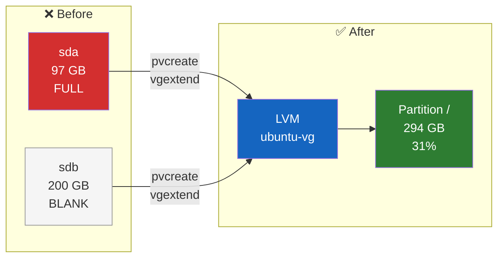

<p align="center">
  <a href="README.md">English</a> &bull;
  <a href="README_fr.md">Français</a>
</p>

<div align="center">

# 💾 Live LVM Extension on Ubuntu

**Add a disk and extend the system partition without service interruption**

> Step-by-step operational guide: this repository does not contain an automated script.


</div>

---

## 🎯 Context

The server reached **disk space saturation** (100% on the root partition `/`). A new blank virtual disk was added to the virtual machine from the hypervisor (vSphere, Proxmox, etc.) **without shutting it down**.

**Goal:** Merge this new disk with the existing system partition in order to extend the storage space **live** (without service interruption), using **LVM** (Logical Volume Manager) technology.

---

## ⚠️ Mandatory prerequisites

> **Never handle the partitions of a production server without a safety net.**

- Have identified the name of the new blank disk (here `/dev/sdb`)
- Have a **verified backup**; a hypervisor snapshot can complement this protection, but does not always replace it

---

## 📋 Procedure

### Step 1: Checking the initial state

Before any handling, the critical state of the disk and the exact name of the partition to be enlarged are checked.

```bash
df -h
```

Locate the line mounted on `/` (e.g. `/dev/mapper/ubuntu--vg-ubuntu--lv`) and its usage rate.

**Example: Before (saturated disk):**
```
Filesystem                         Size  Used Avail Use% Mounted on
/dev/mapper/ubuntu--vg-ubuntu--lv   97G   92G     0 100% /
```

---

### Step 2: Preparing the new disk (Physical Volume)

The new blank disk (`sdb`) is declared to the LVM manager so that it recognizes it as a usable component.

```bash
sudo pvcreate /dev/sdb
```

> ✅ Expected result: `Physical volume "/dev/sdb" successfully created.`

---

### Step 3: Adding to the volume group (Volume Group)

This new disk is added to the server's main storage group (here `ubuntu-vg`).

```bash
sudo vgextend ubuntu-vg /dev/sdb
```

> ✅ Expected result: `Volume group "ubuntu-vg" successfully extended.`

**💡 How to find the Volume Group name?**
```bash
sudo vgdisplay | grep "VG Name"
```

---

### Step 4: Extending the partition (Logical Volume)

Now that the group has free space, the logical system partition is stretched so that it consumes 100% of the new available space.

```bash
sudo lvextend -l +100%FREE /dev/mapper/ubuntu--vg-ubuntu--lv
```

> ✅ Expected result: `Logical volume ubuntu-vg/ubuntu-lv successfully resized.`

---

### Step 5: Resizing the filesystem

LVM has enlarged the "box", but the operating system (`ext4`) does not know it yet. The filesystem is forced to spread across all the new available space. This is the only step that takes a few seconds.

```bash
sudo resize2fs /dev/mapper/ubuntu--vg-ubuntu--lv
```

> ✅ Expected result: `The filesystem on [...] is now XXXXX blocks long.`

**⚠️ If the filesystem is `xfs` instead of `ext4`:**
```bash
sudo xfs_growfs /
```

---

### Step 6: Final validation

The space is checked to confirm that it was indeed added to the system live.

```bash
df -h
```

**Example: After (extended space):**
```
Filesystem                         Size  Used Avail Use% Mounted on
/dev/mapper/ubuntu--vg-ubuntu--lv  294G   87G  195G  31% /
```

The usage percentage has dropped drastically, and the total space has increased. ✅

---

## 🏗️ How does it work?



**LVM in a nutshell:**
- **Physical Volume (PV)** = a physical disk declared to LVM
- **Volume Group (VG)** = a storage pool grouping one or more PVs
- **Logical Volume (LV)** = a virtual partition carved out of the VG

The advantage: disks can be added to the VG and the LV extended **live**, without unmounting or reformatting.

---

## 🔁 Command summary

```bash
# 1. Check the state
df -h

# 2. Prepare the new disk
sudo pvcreate /dev/sdb

# 3. Add to the volume group
sudo vgextend ubuntu-vg /dev/sdb

# 4. Extend the partition
sudo lvextend -l +100%FREE /dev/mapper/ubuntu--vg-ubuntu--lv

# 5. Resize the filesystem
sudo resize2fs /dev/mapper/ubuntu--vg-ubuntu--lv

# 6. Verify
df -h
```

---

## 🐛 Troubleshooting

| Issue | Solution |
|---|---|
| `No such device /dev/sdb` | The disk was not detected. Rescan: `echo "- - -" \| sudo tee /sys/class/scsi_host/host*/scan` |
| `Physical volume already exists` | The disk is already initialized. Check with `sudo pvs` |
| `Volume group not found` | Check the exact name: `sudo vgdisplay \| grep "VG Name"` |
| `resize2fs: Bad magic number` | The filesystem is probably `xfs`, use `sudo xfs_growfs /` |
| Space not updated after resize2fs | Check that the LV was indeed extended: `sudo lvs` |

---

## 📄 License

MIT
