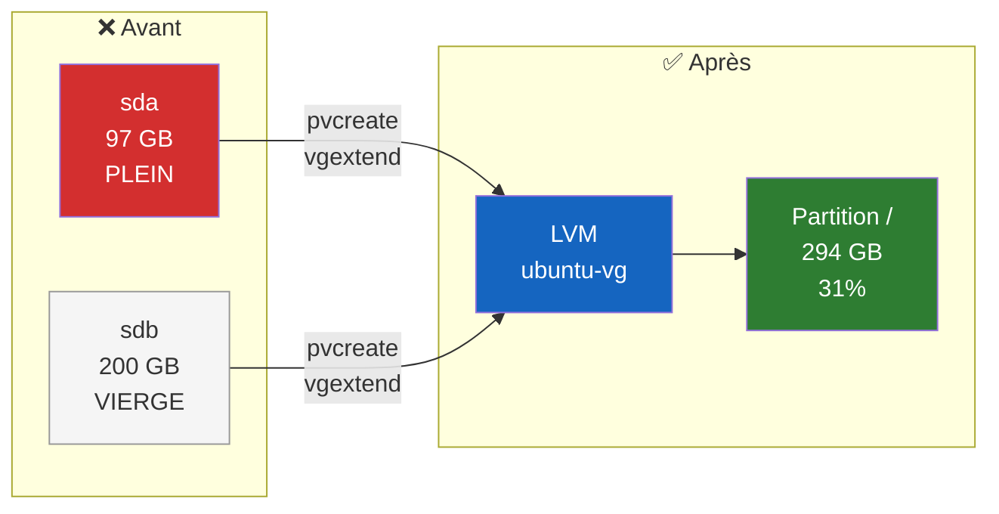

<p align="center">
  <a href="README.md">English</a> &bull;
  <a href="README_fr.md">Français</a>
</p>

<div align="center">

# 💾 Extension LVM à chaud sur Ubuntu

**Ajouter un disque et étendre la partition système sans interruption de service**

> Guide opérationnel pas à pas — ce dépôt ne contient pas de script automatique.


</div>

---

## 🎯 Contexte

Le serveur est arrivé à **saturation d'espace disque** (100% sur la partition racine `/`). Un nouveau disque virtuel vierge a été ajouté à la machine virtuelle depuis l'hyperviseur (vSphere, Proxmox, etc.) **sans l'éteindre**.

**Objectif :** Fusionner ce nouveau disque avec la partition système existante pour étendre l'espace de stockage **à chaud** (sans interruption de service), en utilisant la technologie **LVM** (Logical Volume Manager).

---

## ⚠️ Prérequis obligatoires

> **Ne jamais manipuler les partitions d'un serveur en production sans filet de sécurité.**

- Avoir identifié le nom du nouveau disque vierge (ici `/dev/sdb`)
- Disposer d'une **sauvegarde vérifiée** ; un snapshot hyperviseur peut compléter cette protection, mais ne la remplace pas toujours

---

## 📋 Procédure

### Étape 1 — Vérification de l'état initial

Avant toute manipulation, on vérifie l'état critique du disque et le nom exact de la partition à agrandir.

```bash
df -h
```

Repérer la ligne montée sur `/` (ex: `/dev/mapper/ubuntu--vg-ubuntu--lv`) et son taux d'utilisation.

**Exemple — Avant (disque saturé) :**
```
Filesystem                         Size  Used Avail Use% Mounted on
/dev/mapper/ubuntu--vg-ubuntu--lv   97G   92G     0 100% /
```

---

### Étape 2 — Préparation du nouveau disque (Physical Volume)

On déclare le nouveau disque vierge (`sdb`) au gestionnaire LVM pour qu'il le reconnaisse comme un composant utilisable.

```bash
sudo pvcreate /dev/sdb
```

> ✅ Résultat attendu : `Physical volume "/dev/sdb" successfully created.`

---

### Étape 3 — Ajout au groupe de volumes (Volume Group)

On ajoute ce nouveau disque au groupe de stockage principal du serveur (ici `ubuntu-vg`).

```bash
sudo vgextend ubuntu-vg /dev/sdb
```

> ✅ Résultat attendu : `Volume group "ubuntu-vg" successfully extended.`

**💡 Comment trouver le nom du Volume Group ?**
```bash
sudo vgdisplay | grep "VG Name"
```

---

### Étape 4 — Extension de la partition (Logical Volume)

Maintenant que le groupe a de l'espace libre, on étire la partition logique système pour qu'elle consomme 100% du nouvel espace disponible.

```bash
sudo lvextend -l +100%FREE /dev/mapper/ubuntu--vg-ubuntu--lv
```

> ✅ Résultat attendu : `Logical volume ubuntu-vg/ubuntu-lv successfully resized.`

---

### Étape 5 — Redimensionnement du système de fichiers

LVM a agrandi la "boîte", mais le système d'exploitation (`ext4`) ne le sait pas encore. On force le système de fichiers à s'étaler dans tout le nouvel espace disponible. C'est la seule étape qui prend quelques secondes.

```bash
sudo resize2fs /dev/mapper/ubuntu--vg-ubuntu--lv
```

> ✅ Résultat attendu : `The filesystem on [...] is now XXXXX blocks long.`

**⚠️ Si le système de fichiers est `xfs` au lieu de `ext4` :**
```bash
sudo xfs_growfs /
```

---

### Étape 6 — Validation finale

On vérifie que l'espace a bien été ajouté au système à chaud.

```bash
df -h
```

**Exemple — Après (espace étendu) :**
```
Filesystem                         Size  Used Avail Use% Mounted on
/dev/mapper/ubuntu--vg-ubuntu--lv  294G   87G  195G  31% /
```

Le pourcentage d'utilisation a drastiquement chuté, et l'espace total a augmenté. ✅

---

## 🏗️ Comment ça marche ?



**LVM en résumé :**
- **Physical Volume (PV)** = un disque physique déclaré à LVM
- **Volume Group (VG)** = un pool de stockage regroupant un ou plusieurs PV
- **Logical Volume (LV)** = une partition virtuelle taillée dans le VG

L'avantage : on peut ajouter des disques au VG et étendre le LV **à chaud**, sans démonter ni reformater.

---

## 🔁 Récapitulatif des commandes

```bash
# 1. Vérifier l'état
df -h

# 2. Préparer le nouveau disque
sudo pvcreate /dev/sdb

# 3. Ajouter au groupe de volumes
sudo vgextend ubuntu-vg /dev/sdb

# 4. Étendre la partition
sudo lvextend -l +100%FREE /dev/mapper/ubuntu--vg-ubuntu--lv

# 5. Redimensionner le système de fichiers
sudo resize2fs /dev/mapper/ubuntu--vg-ubuntu--lv

# 6. Vérifier
df -h
```

---

## 🐛 Dépannage

| Problème | Solution |
|---|---|
| `No such device /dev/sdb` | Le disque n'a pas été détecté. Rescanner : `echo "- - -" \| sudo tee /sys/class/scsi_host/host*/scan` |
| `Physical volume already exists` | Le disque est déjà initialisé. Vérifier avec `sudo pvs` |
| `Volume group not found` | Vérifier le nom exact : `sudo vgdisplay \| grep "VG Name"` |
| `resize2fs: Bad magic number` | Le filesystem est probablement `xfs`, utiliser `sudo xfs_growfs /` |
| Espace non mis à jour après resize2fs | Vérifier que le LV a bien été étendu : `sudo lvs` |

---

## 📄 Licence

MIT
